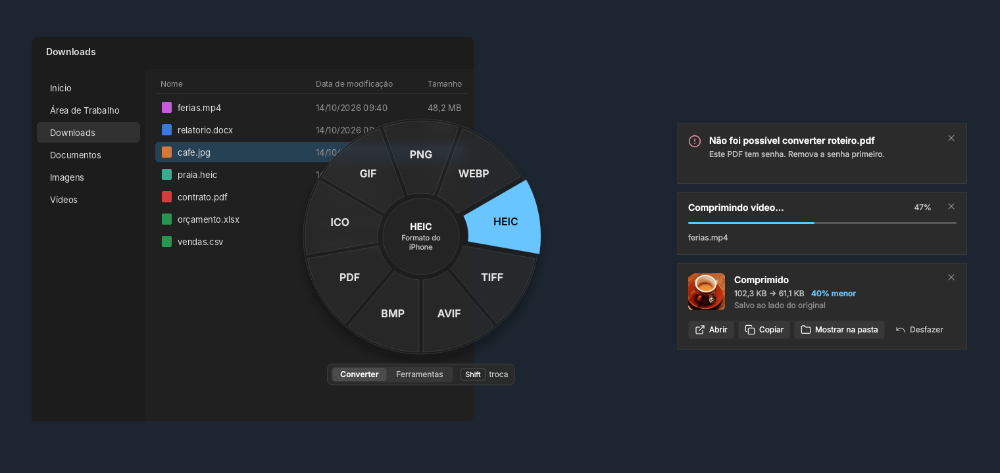
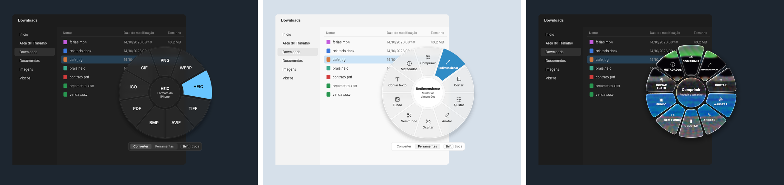
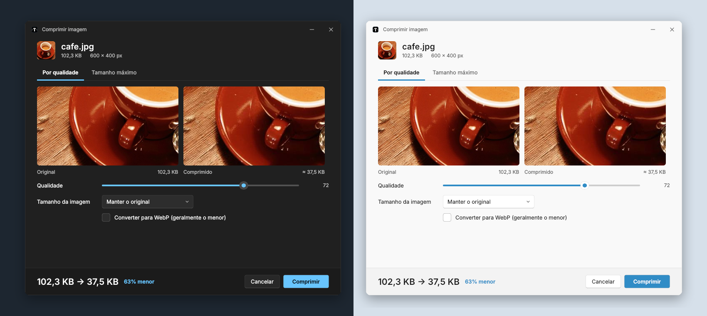
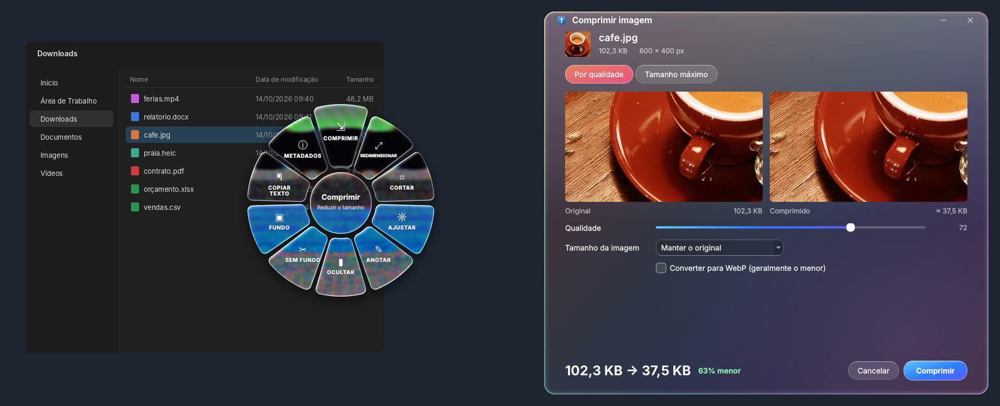
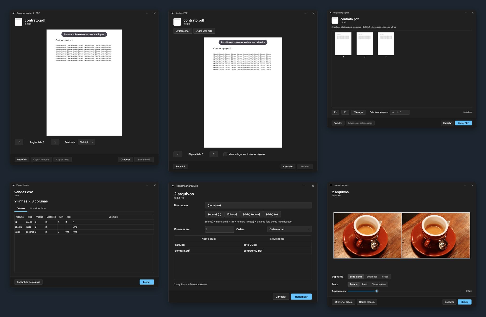
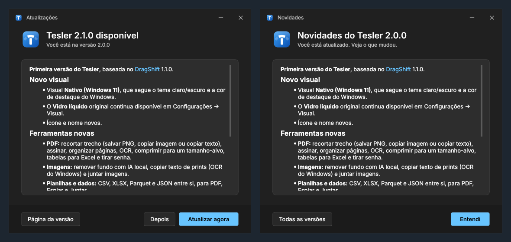

<p align="center">
  
</p>

<h1 align="center">Tesler</h1>

<p align="center">
  <b>Arraste. Aperte Shift. Solte.</b><br>
  Converta, comprima e edite qualquer arquivo no Windows sem abrir programa nenhum.
</p>

<p align="center">
  
  
  
  
  
</p>

<p align="center">
  
</p>

O Tesler aparece embaixo do cursor no meio de um arrastar: comece a arrastar um arquivo, aperte **Shift** e solte numa fatia do menu. O resultado é salvo **ao lado do original** e o original nunca é alterado. Uma notificação mostra o que mudou (*102 KB → 61 KB · 40% menor*) com botões para **Abrir**, **Copiar**, **Mostrar na pasta** e **Desfazer**.

Tudo roda no seu computador: nenhum arquivo é enviado para a internet, nem para remover fundo com IA.

> [!NOTE]
> O Tesler é uma versão estendida do **[DragShift](https://github.com/llamaboi55/DragShift)**, de **llamaboi55**. A ideia do menu radial, o motor de conversão e o visual de vidro líquido vêm de lá. Esta versão adiciona dezenas de ferramentas, uma interface nativa do Windows 11 e tradução completa para o português. Detalhes em [Créditos](#créditos).

> [!IMPORTANT]
> **O Tesler é feito para Windows 10 e 11.** Ele não foi testado no Mac nem no Linux, e o instalador e as atualizações existem só para Windows. Veja [Compatibilidade](#compatibilidade).

---

## Sumário

- [Como usar](#como-usar)
- [Dois visuais](#dois-visuais)
- [O que dá pra fazer](#o-que-dá-pra-fazer)
- [Ferramentas novas em destaque](#ferramentas-novas-em-destaque)
- [Instalação](#instalação)
- [Configurações](#configurações)
- [Compatibilidade](#compatibilidade)
- [Curtiu o Tesler?](#curtiu-o-tesler)
- [Créditos](#créditos)
- [Licença](#licença)
- [Para desenvolvedores](#para-desenvolvedores)

---

## Como usar

| | |
|---|---|
| **1. Arraste** | Comece a arrastar qualquer arquivo no Explorador ou na Área de Trabalho. |
| **2. Aperte Shift** | O menu abre embaixo do cursor, com os formatos para **Converter**. |
| **3. Shift de novo** | Troca para **Ferramentas** (comprimir, recortar, assinar, OCR…). |
| **4. Solte** | Solte o arquivo na fatia. Pronto. |

Arrastou vários arquivos de uma vez? O Tesler oferece o que faz sentido para o grupo: juntar PDFs, montar uma colagem, juntar planilhas, renomear em lote.

Também dá para usar sem arrastar: botão direito no arquivo → **Tesler…**, **Enviar para → Tesler**, ou dois cliques no ícone da bandeja para escolher um arquivo.

---

## Dois visuais

Em **Configurações → Visual** você escolhe o que preferir:

<p align="center">
  
</p>

| **Nativo (Windows 11)** | **Vidro líquido (clássico)** |
|---|---|
| Superfícies sóbrias, ícones de traço, cantos e sombras do próprio Windows. Segue o **tema claro/escuro** e a **cor de destaque** que você escolheu no Windows. | O visual original do DragShift: vidro que refrata o que está atrás, com borda de arco-íris. Sempre escuro. |

<p align="center">
  
</p>

<details>
<summary><b>Ver o visual clássico</b></summary>
<br>
<p align="center">
  
</p>
</details>

---

## O que dá pra fazer

Legenda: 🆕 = novo no Tesler · sem marca = herdado do DragShift (muitas vezes melhorado).

### Imagens
*JPG, PNG, WEBP, HEIC, AVIF, TIFF, BMP, GIF, ICO*

| Ação | O que faz |
|---|---|
| **Converter** | Para qualquer um desses formatos ou PDF. Várias imagens viram um PDF só. |
| **Comprimir** | Por qualidade ou até um tamanho-alvo ("abaixo de 500 KB"), com prévia antes/depois e estimativa ao vivo. |
| **Redimensionar · Cortar · Ajustar** | Proporções prontas, rotação, luz e cor, preto e branco, segurar para comparar. |
| **Anotar · Ocultar** | Setas, caixas, passos numerados, texto, marca-texto; tarjas para esconder dados. |
| **Fundo** | Coloca a imagem sobre um fundo em gradiente. |
| **Metadados** | Câmera, data e GPS (com link do mapa); apaga só a localização ou tudo. |
| 🆕 **Sem fundo** | Remove o fundo com IA, **no seu computador** (modelo IS-Net). |
| 🆕 **Copiar texto** | OCR do próprio Windows: arraste um print e o texto vai para a área de transferência em menos de 1 segundo. |
| 🆕 **Juntar** | Várias imagens lado a lado, empilhadas ou em grade, com espaçamento e fundo. Salva ou copia. |

### PDF

| Ação | O que faz |
|---|---|
| **Converter** | Para JPG/PNG (uma por página), DOCX ou TXT. |
| **Dividir · Girar · Mesclar · Proteger · Extrair imagens** | Um PDF por página, girar 90°, juntar vários, senha AES-256, salvar as imagens embutidas. |
| 🆕 **Recortar trecho** | Selecione uma área da página e **salve como PNG**, **copie a imagem** ou **copie o texto** dela. |
| 🆕 **Assinar** | Desenhe a assinatura ou importe de uma foto (o fundo é limpo sozinho), posicione e aplique numa página ou em todas. |
| 🆕 **Organizar páginas** | Miniaturas para arrastar e reordenar, girar, apagar e extrair páginas selecionadas. Também define a ordem ao **mesclar**. |
| 🆕 **OCR** | Transforma um PDF escaneado em PDF pesquisável, com texto selecionável. |
| 🆕 **Comprimir** | Escolha um tamanho-alvo e o Tesler ajusta a qualidade das imagens até chegar lá. |
| 🆕 **Tabelas → Excel** | Extrai as tabelas do PDF para XLSX, célula por célula. |
| 🆕 **Tirar senha** | Remove a senha de um PDF que você já sabe abrir. |

### Planilhas e dados 🆕
*CSV, TSV, XLSX, Parquet, JSON, JSONL*

| Ação | O que faz |
|---|---|
| **Converter** | CSV ⇄ XLSX ⇄ Parquet ⇄ JSON. Entende `;` como separador e números no formato brasileiro (`1.234,56`). |
| **Para PDF** | CSV/XLSX viram uma tabela em PDF pronta para mandar. |
| **Espiar** | Abre um raio-x do arquivo sem precisar do Excel: colunas, tipos, vazios, mínimos e máximos, primeiras linhas. |
| **Juntar** | Vários arquivos viram um só, com as colunas casadas pelo nome. |

### Vídeo e áudio 🆕
*MP4, MOV, MKV, WEBM, MP3, WAV, M4A…*

| Ação | O que faz |
|---|---|
| **Converter** | MP4, GIF, MP3, WAV, M4A, com barra de progresso na notificação. |
| **Comprimir vídeo** | Reduz o tamanho mantendo a qualidade visível. |

### Documentos

| Ação | O que faz |
|---|---|
| **Word (.docx)** | Para PDF (usa o Word se estiver instalado) ou TXT. |
| **Texto (.txt, .md…)** | Para PDF ou DOCX. |

### Qualquer arquivo 🆕

| Ação | O que faz |
|---|---|
| **Renomear em lote** | Padrões com `{nome}`, `{n}` e `{data}` (data da foto ou de modificação), prévia antes de aplicar e **desfazer** depois. |

---

## Ferramentas novas em destaque

<p align="center">
  
</p>

<p align="center"><sub>Recortar trecho do PDF · Assinar · Organizar páginas · Espiar dados · Renomear em lote · Juntar imagens</sub></p>

E nas notificações:

- 🆕 **Copiar**: copia o arquivo gerado (ou o texto, no OCR) direto para colar no WhatsApp, e-mail ou Teams.
- 🆕 **Barra de progresso** em tarefas longas, como vídeo e remoção de fundo.
- **Desfazer** manda o arquivo novo para a Lixeira; no renomear em lote, volta os nomes originais.

---

## Instalação

1. Baixe o **[Tesler-Setup.exe](https://github.com/VictorJurado18/tesler/releases/latest/download/Tesler-Setup.exe)** da [página de versões](https://github.com/VictorJurado18/tesler/releases/latest).
2. Abra e siga o instalador. Ele instala só para o seu usuário, então não pede senha de administrador. Pronto: o Tesler fica na bandeja do sistema, ao lado do relógio.

O instalador também cria o atalho no menu Iniciar, a opção **Tesler…** no botão direito dos arquivos, o **Enviar para → Tesler** e, se você quiser, a inicialização com o Windows. Para desinstalar: Configurações do Windows → Aplicativos.

Prefere não instalar? Baixe o **Tesler-Portable.exe** e rode de qualquer pasta.

> [!WARNING]
> Na primeira vez, o Windows pode mostrar **"O Windows protegeu o computador"**, porque o app ainda não tem assinatura digital paga. Clique em **Mais informações → Executar assim mesmo**. O código é todo aberto, aqui neste repositório.

> [!NOTE]
> Na primeira vez que usar **Sem fundo**, o Tesler baixa o modelo de IA (cerca de 170 MB) para `%LOCALAPPDATA%\Tesler\models`. Depois disso funciona offline.

### Atualizações automáticas

O Tesler procura versões novas uma vez por dia. Quando sai uma, aparece uma notificação: clique, veja o que mudou e toque em **Atualizar agora**. Ele baixa, confere o arquivo, instala, fecha e abre sozinho. Na primeira vez que a versão nova abre, ela mostra as novidades.

<p align="center">
  
</p>

Também dá para procurar na hora: botão direito no ícone da bandeja → **Procurar atualizações…**, ou em **Configurações → Atualizações → Verificar agora**. A verificação automática pode ser desligada ali.

---

## Configurações

Clique com o botão direito no ícone da bandeja → **Configurações**:

| Opção | Escolhas |
|---|---|
| **Idioma** | Automático, Português, English |
| **Visual** | Nativo (Windows 11) · Vidro líquido (clássico) |
| **Tema** | Automático (segue o Windows) · Escuro · Claro |
| **Tecla do menu** | Shift, Ctrl ou Alt |
| **Onde salvar** | Ao lado do original ou numa subpasta `Tesler` |
| **Qualidade** | JPG/WebP e resolução de PDF → imagem |
| **Iniciar com o Windows** | Liga ou desliga |
| **Atualizações** | Verificar automaticamente · Verificar agora |

Idioma e visual valem depois de reiniciar o app.

> [!NOTE]
> Quem usava o DragShift não perde nada: na primeira vez que o Tesler abre, ele traz as configurações, as assinaturas salvas, o modelo de IA e a inicialização com o Windows.

---

## Compatibilidade

| Sistema | Situação |
|---|---|
| **Windows 11** | ✅ Suportado. É onde o Tesler é desenvolvido e usado no dia a dia. Antes de cada versão ser publicada, o GitHub roda os testes, instala e testa o app numa máquina Windows. |
| **Windows 10** | ✅ Suportado, mas menos testado no uso real. O visual nativo perde só os cantos arredondados, que são do Windows 11. |
| **macOS** | ⚠️ Não suportado. O código herdado do DragShift ainda tem partes para Mac, mas **nada do Tesler foi testado nele** e não há instalador. |
| **Linux** | ⚠️ Não suportado. Mesma situação do macOS. |

Se alguém rodar o código-fonte no Mac ou no Linux por conta própria, algumas ferramentas certamente não funcionam porque usam recursos do Windows: **Copiar texto** de imagens e **OCR** de PDF (usam o reconhecimento de texto do Windows), **planilha → PDF** com o layout do Excel e a **atualização automática**. As demais podem funcionar, mas sem garantia.

Quer usar no Mac ou no Linux? Abra uma [issue](https://github.com/VictorJurado18/tesler/issues) contando seu caso.

---

## Curtiu o Tesler?

Se ele te poupou um tempinho, um cafezinho ajuda a manter o projeto vivo. Mas fica tranquilo: usar o app continua 100% livre. ☕


**Pix (copie e cole):** `f608aca6-81f0-4c41-a77f-347777f75b0e`<br>
**Recebedor:** Victor Nemeth Jurado · São Paulo

No app, o mesmo QR Code fica em botão direito no ícone da bandeja → **Apoiar o Tesler ♥**.

---

## Créditos

O Tesler existe graças ao **[DragShift](https://github.com/llamaboi55/DragShift)**, criado por **llamaboi55** e publicado sob a licença MIT. Do projeto original vêm:

- a ideia de **Shift + arrastar** para abrir um menu radial em qualquer lugar do sistema;
- o motor de conversão de imagens, PDF, Word e texto;
- as ferramentas de comprimir, redimensionar, cortar, ajustar, anotar, ocultar, fundo, metadados, dividir, girar, mesclar, proteger e extrair imagens;
- o visual de **vidro líquido**, que segue disponível como opção;
- o instalador, a integração com o menu de contexto e "Enviar para", e os testes de ponta a ponta.

Se o DragShift te ajudou, considere [apoiar o autor original](https://github.com/llamaboi55/DragShift#support).

O nome é uma homenagem a **[Larry Tesler](https://pt.wikipedia.org/wiki/Larry_Tesler)** (1945–2020), cientista da computação que criou o **recortar, copiar e colar**. O ícone brinca com isso: a barra do **T** é uma fatia do menu radial, "recortada" e levantada.

Outros projetos que tornam o Tesler possível: [Qt / PySide6](https://www.qt.io/qt-for-python), [PyMuPDF](https://pymupdf.readthedocs.io), [Pillow](https://python-pillow.org), [ONNX Runtime](https://onnxruntime.ai), [IS-Net / DIS](https://github.com/xuebinqin/DIS), [FFmpeg](https://ffmpeg.org), [openpyxl](https://openpyxl.readthedocs.io), [Apache Arrow](https://arrow.apache.org) e os ícones [Lucide](https://lucide.dev).

---

## Licença

O código do Tesler segue a licença **[MIT](LICENSE)** do projeto original: livre para usar, modificar e compartilhar, mantendo o aviso de copyright.

Algumas dependências têm licenças próprias, que valem quando você distribui o app empacotado: **PyMuPDF** (AGPL-3.0), **FFmpeg** (GPL), **PySide6** (LGPL-3.0) e o modelo **IS-Net** (Apache-2.0). Como o Tesler é open source, isso é compatível; só mantenha o código-fonte disponível ao distribuir.

---

## Para desenvolvedores

### Rodar pelo código-fonte

1. Instale o **[Miniconda](https://docs.conda.io/en/latest/miniconda.html)** e crie o ambiente:
   ```bat
   conda create -n dragshift python=3.12 -y
   conda activate dragshift
   pip install -r requirements.txt
   ```
2. Dê dois cliques em **`Iniciar Tesler.bat`**. Ele instala sozinho os componentes que faltarem sempre que o projeto mudar.

```bash
python -m dragshift            # abre o app
python -m dragshift --selftest # testa todas as conversões e janelas
python -m pytest -q            # testes (rodam nos dois visuais)
```

### Publicar uma versão nova

O GitHub Actions faz tudo. Para lançar a versão `2.1.0`, por exemplo:

1. Troque o número em `dragshift/__init__.py` para `__version__ = "2.1.0"`.
2. Escreva as novidades em `CHANGELOG.md`, numa seção `## 2.1.0` no topo.
3. Mande para a `main`.

O workflow [`build.yml`](.github/workflows/build.yml) roda os testes, gera o app, o instalador e o portátil, testa a instalação de verdade num Windows e publica o release `v2.1.0` com as notas do CHANGELOG. A partir daí, quem tem o Tesler instalado recebe a atualização. Push sem mudar a versão só gera o build, sem publicar nada.

### Organização do código

- O código fica em `dragshift/` (o nome interno do pacote foi mantido para não quebrar instalações existentes).
- O visual é controlado por `theme.py` (cores, tema, cor de destaque do Windows) e `glass.py` (folha de estilo e o vidro clássico). Os ícones de traço estão em `icons.py`.
- As atualizações ficam em `updater.py` (GitHub Releases, download conferido por SHA-256) e `updatewin.py` (janelas).
- Os logs ficam em `%LOCALAPPDATA%\Tesler\log.txt`.
- O Tesler é só para Windows (veja [Compatibilidade](#compatibilidade)). O código herdado para Mac e Linux (`platform_mac.py`, `platform_linux.py`, `packaging/`) ficou no repositório, mas não é mantido nem testado.

<p align="center"><sub>Feito no Brasil 🇧🇷 a partir do DragShift.</sub></p>
